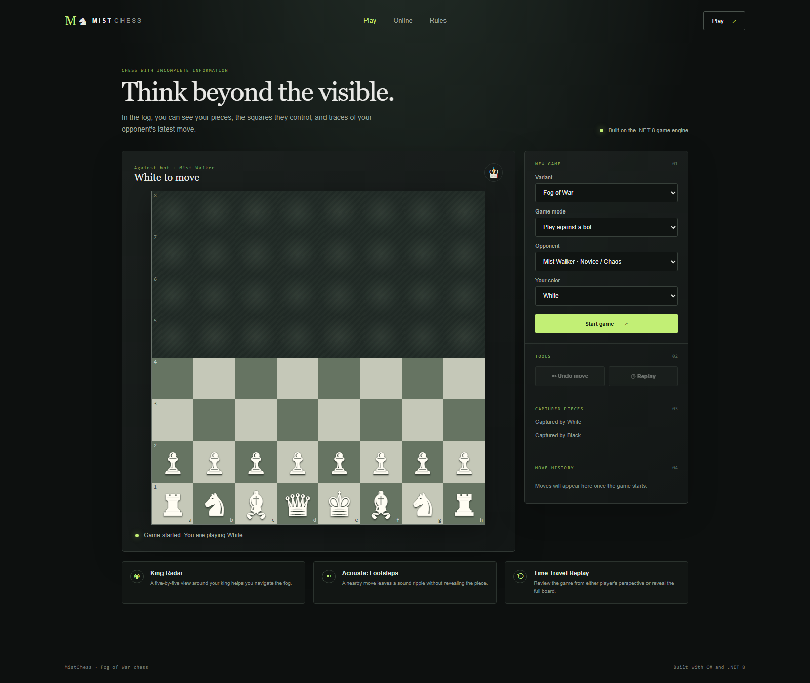
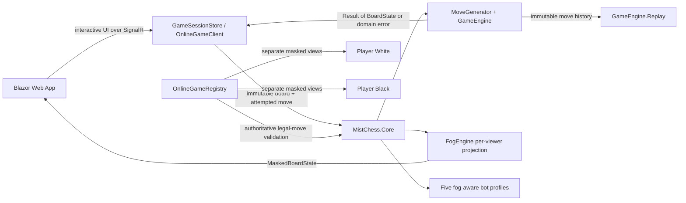

# MistChess — Fog of War Chess

**MistChess** is a playable chess web application built with C# and .NET 8. It combines an immutable functional game engine with hidden-information chess, five bot profiles, local two-player play, and browser-based online rooms.

**Authors:** Sansyzbay Dossymzhan and Meiram Dossym

## Play locally

Install the .NET 8 SDK, clone this repository, then run:

```powershell
dotnet run --project src/MistChess.Web
```

Open the local URL printed in the terminal (the included HTTP profile uses `http://localhost:5254`). The home screen supports games against all five bots and two players sharing one screen. Use the **Online** page to create a room, send the eight-character code to another player, and play through the Blazor Interactive Server connection.

## Public demo

**Play the live game:** [mistchess-fog-of-war.vercel.app](https://mistchess-fog-of-war.vercel.app)

The public GitHub repository is deployed to Vercel. Vercel uses `Dockerfile.vercel` to build and run the .NET 8 Blazor application as a container. Use the button below if you want to create a separate deployment under another Vercel team.

[](https://vercel.com/new/clone?repository-url=https%3A%2F%2Fgithub.com%2Fdosiks2028%2Fmistchess-fog-of-war)

The container runtime supports real-time WebSocket connections, but it can recycle function instances and end long-running connections at its configured duration limit. This Blazor Server app keeps online rooms in process memory, so rooms can be lost on restart and cross-instance online play is not guaranteed. Bot games and local two-player games do not depend on shared online-room state.

## Browser screenshot

This is a live browser capture of the deployed English interface at the initial Fog of War position:



Run the automated test suite with:

```powershell
dotnet test MistChess.sln
```

## Game modes

- **Fog of War:** each player sees their own pieces, the squares those pieces attack, and a 5×5 King Radar area around their king. Nearby opponent movement can leave an acoustic ripple without exposing the moved piece. Victory is achieved by capturing the opposing king.
- **Classic Chess:** full board visibility, check and checkmate, castling restrictions, stalemate, and draw rules.
- **Play a bot:** choose one of five profiles and play as White or Black. Bot calculation runs away from the UI thread; undo removes a full human/bot exchange when available.
- **Two players, one screen:** the displayed Fog of War perspective follows the player whose turn it is.
- **Online rooms:** room codes seat the creator as White and the joiner as Black. The server validates turns and legal moves. The online response contains a per-player masked projection, not the hidden pieces or the legal move list. Rooms are held in memory and are lost when the host restarts.
- **Replay:** step through the move history from White Fog, Black Fog, or omniscient perspective.

All six piece types are supported, including captures, castling, en passant, and promotion to queen, rook, bishop, or knight.

## Architecture



`MistChess.Core` contains the domain model, `Result<TValue,TError>`, move generation, game adjudication, fog projection, replay, and bot search. It performs no I/O. The web project owns the user interface and multiplayer room lifecycle. Each online board DTO contains coordinates and only the viewer's visible pieces; the server does not send full board state or legal move lists to clients.

## Fog and replay features

- **King Radar:** reveals the five-by-five area around the player's king.
- **Acoustic Footsteps:** marks the destination of a nearby opponent move while keeping its identity hidden.
- **Time-Travel 3-Layer Replay:** browse the position history through White Fog, Black Fog, or full-board perspectives.
- **Server-side projection:** the room service validates each move against the authoritative board and builds a separate masked projection for each participant.

## Bot profiles

| Bot | Search depth | Style |
| --- | ---: | --- |
| Mist Walker | 1 | Varied novice with a visible-capture bias |
| Zabuza’s Gambit | 1 | Aggressive advancement and explored vision |
| Dementor’s Fork | 2 | Tactical search for visible forks |
| Gaster’s Shadow | 3 | Hidden-king probability estimates |
| Deep Fog | 4 | Alpha-beta search with transposition memoization |

## Verification

The xUnit suite covers chess rules, immutable updates, replay steps, fog masking, bot choices, and the online room service. Registry tests verify room seating, wrong-turn rejection, legal moves, and that an unseen piece remains absent from a player's projected board. The latest run on .NET SDK 8.0.428 passed all 67 tests.

A manual browser smoke check also completed a bot game move and a two-player online game in separate browser sessions. A 390 px mobile viewport had no horizontal overflow. This is a focused smoke check, not a full cross-browser/device matrix or a code-coverage measurement. Run the automated suite with `dotnet test MistChess.sln`.

The app includes a `/health` endpoint for a basic host availability check. The provided room registry is an in-memory demonstration suitable for a single server process; a public production deployment would need persistent room storage, abuse controls, and an agreed hosting environment.

## Defense

The five-slide English presentation covers the aim, technology comparison, architecture, practical value, and method/test results. The [English defense guide](docs/DEFENSE_GUIDE_EN.md) contains a timed demo sequence, technical questions to rehearse, and deployment limitations to state accurately.

## Project structure

```text
src/
  MistChess.Core/     Immutable rules, fog engine, functional result, five bots
  MistChess.Web/      Responsive Blazor UI and authoritative online rooms
tests/
  MistChess.Tests/    Core and online-service unit tests
```

## Five-slide presentation outline

1. **Aim and goals:** playable Fog of War chess; immutable rules, separate player visibility, bots, tests.
2. **Technology and comparison:** C#/.NET 8, Blazor Server, SignalR, and comparison with Chess.com Fog of War.
3. **Architecture:** functional core, per-player projection, authoritative online-room service.
4. **Relevance:** hidden-information decision making, privacy, real-time play, and replay analysis.
5. **Methodology and mockups:** responsive game board, online room entry, test results, and user workflow.
