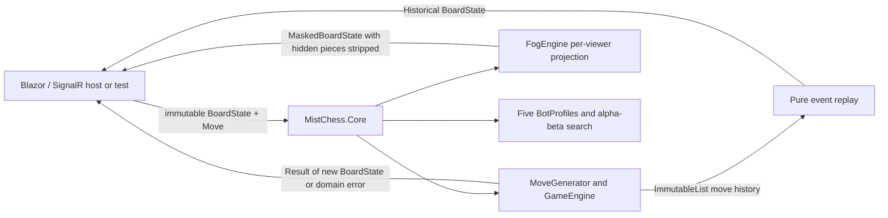
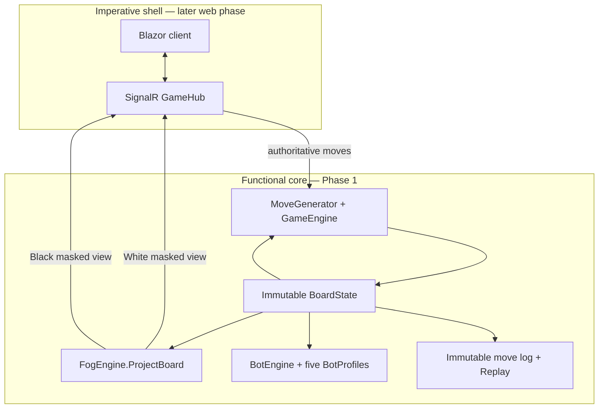
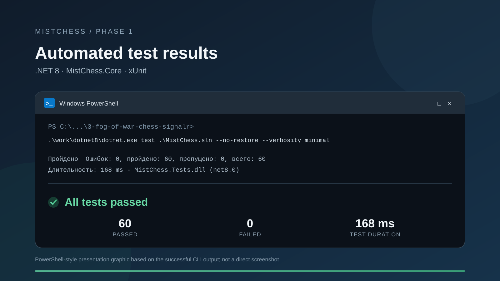

# MistChess

MistChess is a .NET 8 functional core for Fog of War chess. Phase 1 implements the immutable game model, move rules, hidden-information projection, event replay, and five bot profiles. The Blazor interface and multiplayer host are not part of this phase.

## Projects

- `MistChess.Core` contains the immutable domain, `Result<TValue, TError>` and `Option<T>`, legal move generation, game adjudication, fog projection, and bot search.
- `MistChess.Tests` contains xUnit cases for chess rules, immutability, replay, fog privacy, and bot move selection.

## Run

Requires the .NET 8 SDK.

```powershell
dotnet test MistChess.sln
```

To use the engine from another .NET project, reference `src/MistChess.Core/MistChess.Core.csproj`, start from `BoardState.Initial`, and call `GameEngine.ApplyMove` with a move from `MoveGenerator.GetLegalMoves`.

## Game variants and rules

`BoardState.Initial` starts in `GameVariant.FogOfWar`. In this mode, kings may move into attacked squares and castling may pass through or end on attacked squares. The game ends when a king is captured. `GameVariant.ClassicChess` applies king-safety rules, checkmate, stalemate, the fifty-move rule, and insufficient-material draws.

Both variants support pawn, knight, bishop, rook, queen, and king movement, captures, en passant, castling, and promotion to queen, rook, bishop, or knight. Castling rights are removed when a king or home rook moves or a home rook is captured.

## Functional architecture



The domain has no I/O or mutable game state. A future host can use the same pure projection independently for White and Black before sending any board state to a client.

## Fog projection and privacy

`FogEngine.ProjectBoard` returns all 64 coordinates. A hidden square contains only `SquareVisibility.Hidden`; it does not contain the actual piece. The available composable `FogRule` values are:

- `ClassicAttackVision` reveals squares reachable through the pieces’ movement and attack patterns.
- `KingRadarVision` reveals the five-by-five area centered on each friendly king.
- `AcousticFootsteps` marks a nearby opponent move with a ripple and suppresses the moved piece’s identity.

`FogRules.Standard` combines those layers. `GameEngine.Replay` folds a move sequence from an initial position and can reconstruct a historical prefix. Each successful move returns a new immutable board and appends to immutable history.

## Bots

Every bot receives a `MaskedBoardState` and a server-supplied legal root move list. Search simulation uses only pieces present in that observation. The authoritative host must still validate and apply the chosen root move to the truth board.

| Bot | Search depth | Policy |
| --- | ---: | --- |
| Mist Walker | 1 | Seeded variety with a visible-capture bias |
| Zabuza’s Gambit | 1 | Material, pawn advancement, aggression, and explored vision |
| Dementor’s Fork | 2 | Minimax with visible fork and coordination scoring |
| Gaster’s Shadow | 3 | Minimax with a probability distribution over hidden king locations |
| Deep Fog | 4 | Alpha-beta pruning with immutable Zobrist-style transposition memoization |

## Five-slide presentation outline

### Slide 1 — MistChess: aim and goals

**Aim:** Build a Fog of War chess engine that demonstrates functional programming in C# while protecting hidden board state.

**Goals:** Model chess data immutably; implement move validation and game variants; project a separate board view for each player; add five fog-aware bot profiles; verify behavior with automated tests.

**Plan:** Functional core → fog and bot logic → automated verification → Blazor/SignalR host in a later phase.

### Slide 2 — Technology analysis and comparison

Chess.com documents a Fog of War variant where players see their own pieces and reachable squares, and win by capturing the opposing king. Its analysis board supports moving through positions for study. MistChess builds on that baseline with additional core rules and privacy features. The comparison below is limited to those public descriptions.

| Feature | MistChess Phase 1 | Chess.com public documentation |
| --- | --- | --- |
| Fog of War visibility and king capture | Implemented in the core | Documented as a playable variant |
| King Radar | Implemented as a composable vision rule | Not described in the cited Fog of War rules |
| Acoustic Footsteps | Implemented as a ripple that hides piece identity | Not described in the cited Fog of War rules |
| Time-Travel 3-Layer Replay (White fog / Black fog / omniscient) | All three replay projections are implemented in the core; no replay UI yet | Move navigation and analysis are documented; a three-layer fog replay is not described in the cited help article |
| Server-Side Anti-Cheat Projection | Per-viewer masking exists in the core; no SignalR host yet | The cited rules describe player visibility, not server/network architecture |

Sources: [Chess.com Fog of War rules](https://support.chess.com/en/articles/8708650-what-is-fog-of-war-chess), [Chess.com Analysis board](https://support.chess.com/en/articles/8583825-how-do-i-use-the-analysis-board).

### Slide 3 — Architecture



### Slide 4 — Relevance and practical significance

Fog chess makes hidden information part of the strategy. MistChess applies functional programming to a concrete security boundary: the client receives an immutable projection that contains no hidden piece data. The same rules can be replayed deterministically, while seeded bots make decisions reproducible during review and debugging.

### Slide 5 — Methodology and evidence

**Method:** Define immutable domain types → generate legal moves → apply validated moves with `Result` → project fog by viewer → run deterministic bot search → replay move history and verify invariants.

**Current evidence:** 60 xUnit test cases passed on .NET SDK 8.0.428:

```text
Passed!  - Failed:     0, Passed:    60, Skipped:     0, Total:    60, Duration: 168 ms - MistChess.Tests.dll (net8.0)
```



The image is a presentation graphic rendered from the successful command output, not a direct terminal screenshot.

The cases cover move rules, castling, promotion, fog masking, replay, and all five bots. The Blazor board mockup and replay UI belong to the later web phase.
